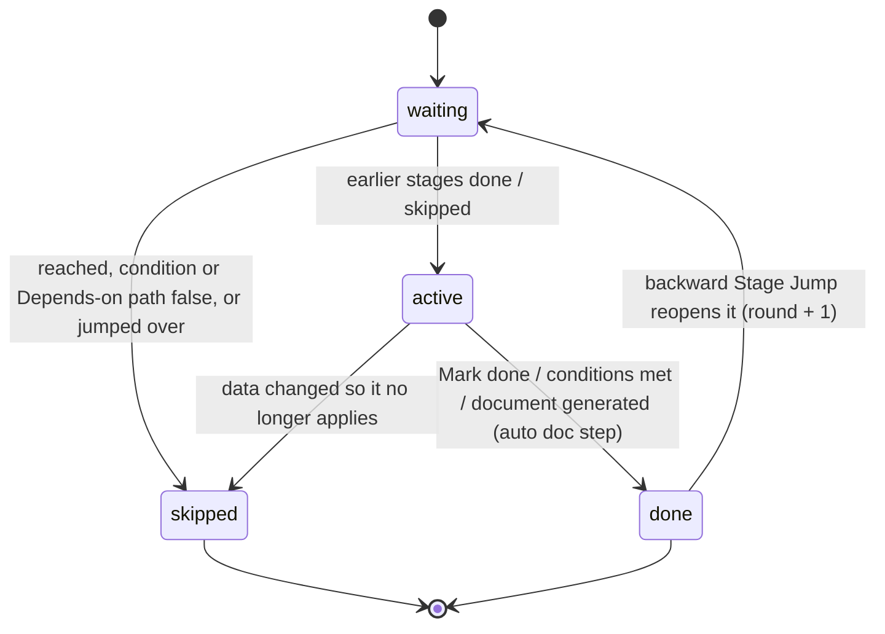
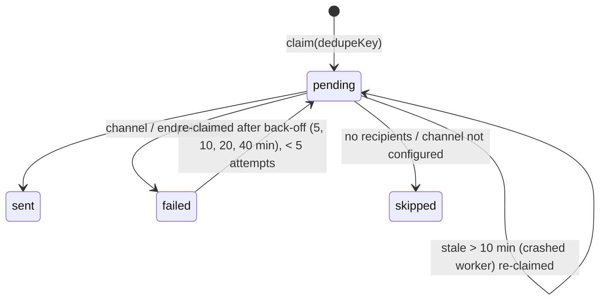
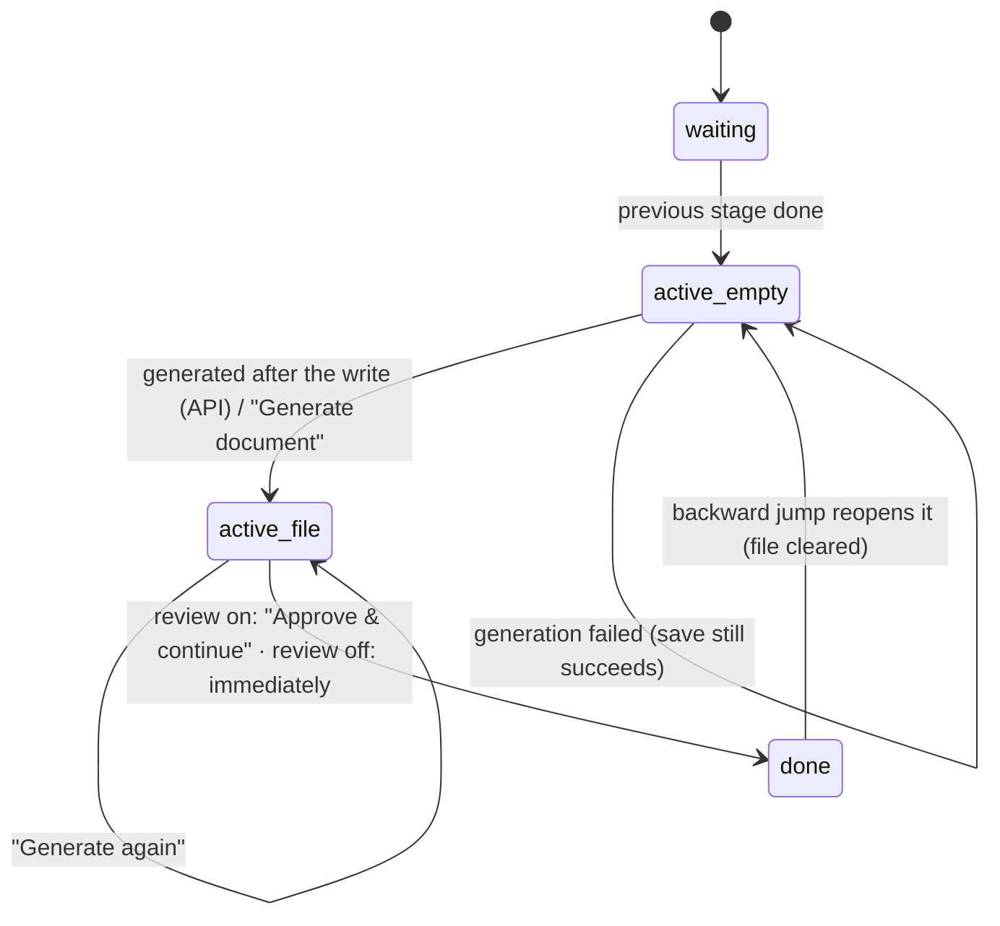

# Implicit state machines

An *implicit* state machine is a lifecycle that exists in behaviour but not in code: it is spread
over several booleans, nullable timestamps or status strings, and its transitions are scattered
`if`s. They tend to allow combinations nobody designed, and transitions that happen without an
event. This is an audit of every one in the platform: what states and transitions it really has,
where it leaked, and what was done about it.

Severity: **High** = can lose or wrongly send data · **Medium** = surprising behaviour users will
hit · **Low** = hygiene.

| # | Machine | Where the state lives | Status |
|---|---|---|---|
| 1 | Stage status | `RecordStage.status/plannedAt/actualAt/round`, derived by `computeTimeline` | **Fixed** (2026-11-23): skips are final once passed |
| 2 | Record lifecycle | `Record.currentStageKey`, `completedAt`, `archivedAt`, `version` | OK (follows #1) |
| 3 | Flow lifecycle | `Workflow.isDraft`, `isActive`, `deletedAt` | **Fixed** — form editor path aligned 2026-11-23 |
| 4 | Organization access | `Organization.isActive`, `licenseExpiresAt` | OK (centralised) |
| 5 | User lockout | `User.failedLogins`, `lockedUntil` | Fixed |
| 6 | Session / refresh token | `RefreshToken.revokedAt`, `family` | Fixed |
| 7 | Super admin context | `User.activeOrgId` + JWT `org` | OK |
| 8 | Delivery (email, WhatsApp, **webhooks**) | `NotificationLog.status/attempts` | Fixed; **webhooks joined 2026-11-23** |
| 9 | Background job runs | `JobRun.status` | Fixed |
| 10 | Client auth session | `status`, `user`, `accessToken`, mock flag | Fixed |
| 11 | Flow editor UI | panel, save, preview, panel width | Explicit reducers; preview/shortcut leaks **fixed 2026-11-23** |
| 12 | Sidebar / menus | `collapsed`, drawer, flyouts | Low, unchanged |
| 13 | Theme | `localStorage fms-theme`, `<html data-theme>`, OS setting | **Medium — fixed 2026-11-23** |
| 14 | Document step | stage status × file field × generation | **New**; one known gap |
| 15 | Public form link | `publicForm`, `publicFormId`, flow + org state | **New**; uniqueness fixed |
| 16 | Stage editability and ownership | lock × access × update mode × status × flow | **Medium — owners misaligned, fixed** |
| 17 | Record page draft vs. version | `draft`, record `version` | **High — fixed** (drafts were silently lost) |
| 18 | Records table selection | `rowSelection` vs. query | **Medium — fixed** |
| 19 | Inspector local copies | colour / video inputs vs. definition | Low — fixed |

---

## 1. Stage status — `packages/core/src/timeline.ts`

**Decision taken (was open):** a skip is **final once the flow has moved past it** — a later stage was
reached or the record finished. Before, editing a field could turn an earlier skipped stage back to
`active`, push the current stage back to `waiting`, wipe its planned time and send nothing (and its
hand-off would never be re-sent). This matches the legacy FMS, where conditional stages were decided
once when reached. Reopening is explicit: a backward Stage Jump (`stage_reopened` event, owners
notified again). Test: `core/test/stage-settings.test.ts` "a skipped stage stays skipped…".

## 2. Record lifecycle

`open` (`currentStageKey` set) → `completed` (`completedAt`); `archived` is orthogonal. With #1 fixed,
`completed → open` only happens through a backward jump (which needs the source stage to complete, so
in practice never after completion). `version` is the optimistic-lock counter (see #17).

## 3. Flow lifecycle — `isDraft × isActive × deletedAt`

| State | isDraft | isActive | deletedAt | How you get there |
|---|---|---|---|---|
| Draft | true | true | – | All Flows › Create, template, duplicate, **form editor › New** |
| Live | false | true | – | Publish (flow editor) |
| Inactive (read-only) | false | false | – | Deactivate on All Flows or in the form editor |
| In trash | any | any | set | Trash (restore keeps the rest) |

* Inactive flows are read-only (edits, completion, planning, document generation rejected).
* Drafts are visible to admins only (`workflowFor`); the worker ignores drafts and inactive flows.
* **Fixed 2026-11-23:** the form editor bypassed the lifecycle — `POST /workflows` created a flow that
  was live at once, and `PUT /workflows/:wf/definition` could set a draft "inactive" (the undefined
  "inactive draft" state). Now it creates drafts, rejects the switch on drafts, and its UI shows
  "Draft — publish in the flow editor" / "Save draft".

## 4–7

Unchanged and fine: organization access is derived in one place (`orgAccessError`); lockout restarts
its count when a lock expires; refresh-token rotation is atomic with a 15-second grace for tab races;
the super admin's acting organization is bound into the access token.

## 8. Delivery — `apps/worker/src/notify.ts`

**Fixed 2026-11-23:** webhooks were not part of this machine. A failure threw, BullMQ retried for about
two minutes and the delivery was then lost with no trace (only successes were logged). Webhooks now
`claim` like every other delivery, record `failed` with the error, and are retried by the sweep with
the same back-off. Blocked (private-network) URLs fail once with attempts exhausted.

## 9–10, 12

Unchanged: stale `running` job rows are closed by the sweep; the offline mock is development-only and
never replaces a real API answer; sidebar state is low-risk local UI.

## 11. Flow editor UI — `apps/web/src/pages/flows/editor`

Explicit reducers (`machines.ts`, unit-tested): panel `closed | node(id) | settings`; save
`idle | saving | saved | failed` (a save can not start while one is in flight). Added since:

* **Preview** (`previewId`): could point at a node that was deleted, and pop up again when an undo
  restored it. Now cleared as soon as its node is gone.
* **Shortcuts under dialogs:** with the preview or a large field editor open, Esc also closed the side
  panel and undo / delete changed the canvas behind the dialog. Shortcuts now stand down while a
  dialog is open (Ctrl+S still saves).
* **Panel width:** `panelWidth` (persisted, clamped to 340 px … 75 % of the window) + `resizing`
  (no width animation while dragging); "wide" layout derives from the width, not a separate flag.
* **Selection vs. panel (2026-11-24):** selection no longer drives the panel. Before, React Flow
  selected a step when a drag started, and `onSelectionChange` then opened its settings — so moving or
  merely touching a step opened them. Now: a click (≤ 5 px of movement) only selects and shows the
  step's toolbar (Settings · Preview · Delete); the panel opens by the toolbar / header gear button,
  double-click or Enter; a click switches the panel only while it is already open on a step. Drags
  start after 5 px, do not select, and snap to neighbouring steps' edges / centres with guide lines.
* **Restore from history:** loads a version into the editor as an ordinary (undoable) edit; the
  snapshot also carries `settings` and `restoredFrom`, so Undo reverts a restore completely and the
  next save is recorded as "Restored from vN".

## 13. Theme — `apps/web/src/lib/theme.ts`

`light | dark | system` × OS preference → `<html data-theme>`.

* **Fixed:** the theme was applied by a hook inside the sidebar layout only. Pages rendered outside it
  — the **flow editor**, **login** and the **public form** — ignored the user's choice when opened
  directly (e.g. "Light" on a dark OS showed dark). Toasts were always light. Now one store applies the
  theme before the first paint on every page, follows OS changes live in `system` mode, and the toast
  container reads the same store.

## 14. Document step

* Rules live in one place, `normalizeDocumentStages` (completion from `requireReview`, file field
  required), applied by the flow editor, the form editor and the API — they could drift before because
  only the canvas compiler set them.
* **Fixed:** a backward jump reopening an automatic document step left the old file in place, so the
  step completed again at once with stale content. Reopened document files are now cleared
  automatically, so the document is regenerated from the corrected data.
* **Known gap:** documents are generated by the API after a user's write. A step that becomes active
  through the worker (e.g. a re-published definition picked up by the sweep), or whose generation
  failed, waits for someone to press **Generate document** on the record page. The worker can not
  generate because local file storage lives on the API node.

## 15. Public form link

`publicForm` (on/off) × `publicFormId` × flow live (not draft, active, not trashed) × organization open.
The link works only when all four allow it; every other combination answers the same 404 so links
can not be probed.

* Switching access off and on again restores the same link (stated in the editor); **New link** retires it.
* **Fixed:** ids were generated in the browser and could be copied between flows through the JSON
  editor; the public route would then pick one of the two flows arbitrarily. The server now owns
  uniqueness (`ensurePublicFormId` on every save path) and the editor adopts the id it returns.
  Duplicates and template copies start private.

## 16. Stage editability and ownership

Whether a user may edit a stage's fields is the product of: stage status (reached?), **Lock after
completion** (done → read-only for everyone), **Stage Access Control** (Viewer / Editor / not listed),
**Single item update** (off → bulk tool only, admins exempt), record archived, flow inactive, and the
field's own rules. The server (`applyChange`) and the record page (`stageBlock`) implement the same
list and show the reason.

**Fixed — who works on a stage was decided three different ways.** With Stage Access Control on, the
API let assigned Editors fill in fields but completing still required the owner *group*, while My
Tasks, the "my tasks" filter, hand-offs, reminders and digests went to the group — so group members got
tasks and emails for stages they could not open, and assigned Editors outside the group never heard
about theirs. Now one rule, `worksOnStage` (core): assigned Editors when restricted, owner groups
otherwise; `canActOnStage` adds the admin override. Used by My Tasks, the list filter, `isMine`,
completion, planning, document regeneration and every worker notification.

**Shown on the record page (2026-11-24):** the record reads as a run of its flow — every step with
its status, who works on it (assigned editors or owner groups) and the viewer's access (fill in / view
only / no access, from the server's `canView` / `canEdit` / `canAct`), the chosen step's timings and
deliveries (admins: failed messages with how to fix them), and what comes next. After a step is
completed (by Mark done, or by a save that meets its conditions) the page follows the record to the
new current step and says who has it now.

**Dependent dropdowns (2026-11-24):** a changed parent clears child values it no longer offers, down
the chain (`staleDependents`, core), in every form and again on the server for fields the user can not
edit. Only children below the edited field are touched, so values from an older option list survive
unrelated edits. Definitions must depend on a dropdown in the same or an earlier stage, never in a
loop, and a header field can not depend on a repeating-row field.

## 17. Record page draft vs. record version

The draft was keyed to the record version: any refetch with a new version (another user's change,
returning to the tab) re-mounted the page and **silently discarded what the user had typed**. Now the
draft remembers the version it started from: untouched drafts rebase quietly; typed drafts are kept,
a banner offers **Reload**, and saving sends the original version so the server answers 409 instead of
overwriting the other change.

## 18. Records table selection

`rowSelection` survived page, filter, sort and status changes, so **Archive** or **Bulk update** could
act on records no longer on screen. The selection now resets whenever the query changes.

## 19. Inspector local copies

The header-colour and instruction-video inputs keep local text while typing (a half-typed link is not
saved). They did not follow undo / redo; they now resync when the stored value changes.

---

Also aligned while auditing: record lists, reports and My Tasks show times in the flow's business
timezone like the record page (they used the browser's); dates use one format; a datetime default of
`TODAY` means the start of the day in the browser as on the server; Connections uses the shared switch.
