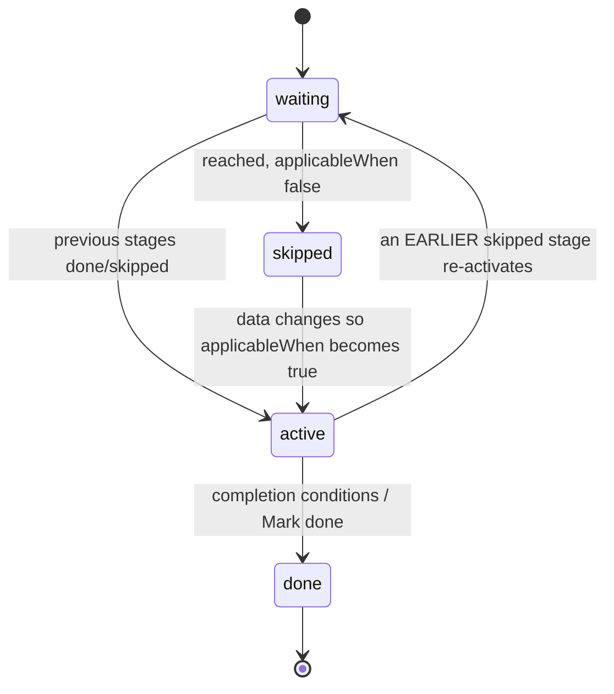
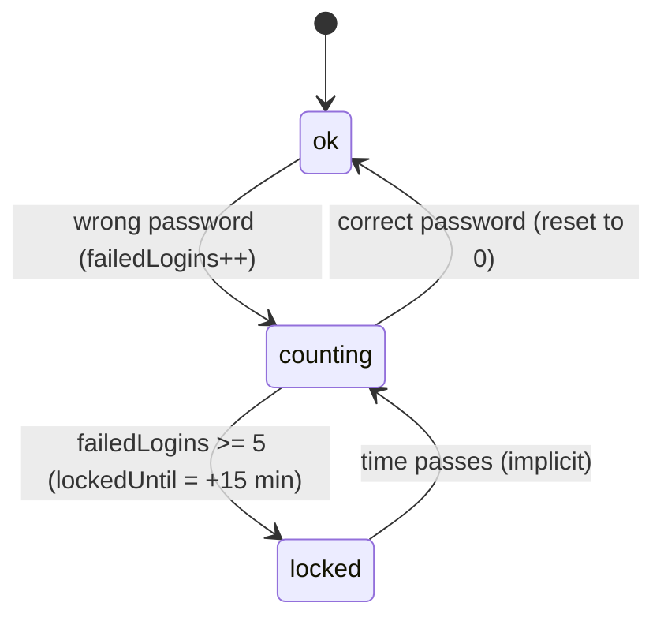
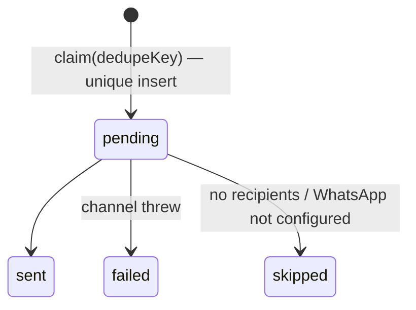

# Implicit state machines

An *implicit* state machine is a lifecycle that exists in behaviour but not in code: it is spread
over several booleans, nullable timestamps or status strings, and its transitions are scattered
`if`s. They tend to allow combinations nobody designed, and transitions that happen without an
event. This is an audit of every one in the platform, what states and transitions it really has,
and where it leaks.

Severity: **High** = can lose or wrongly send data · **Medium** = surprising behaviour users will
hit · **Low** = hygiene.

| # | Machine | Where the state lives | Explicit? | Problems |
|---|---|---|---|---|
| 1 | Stage status | `RecordStage.status/plannedAt/actualAt`, derived by `computeTimeline` | Status enum, transitions implicit | **Medium** — silent regressions |
| 2 | Record lifecycle | `Record.currentStageKey`, `completedAt`, `archivedAt`, `version` | No | Low |
| 3 | Flow lifecycle | `Workflow.isDraft`, `isActive`, `deletedAt` | No | **Medium** — 8 combinations; "read-only" not enforced |
| 4 | Organization access | `Organization.isActive`, `licenseExpiresAt`, `suspendedReason` | Derived (`orgAccessError`) | Low |
| 5 | User account / lockout | `User.isActive`, `failedLogins`, `lockedUntil` | No | **Medium** — lockout never decays |
| 6 | Session (refresh token) | `RefreshToken.revokedAt`, `expiresAt`, `family` | No | **High** — rotation race logs users out |
| 7 | Super admin context | `User.isSuperAdmin`, `activeOrgId`, JWT `org` claim | No | Low |
| 8 | Notification delivery | `NotificationLog.status` (`pending/sent/failed/skipped`) | Status strings | **High** — failures never retried; crashes strand messages |
| 9 | Background job run | `JobRun.status` (`running/succeeded/failed`) | Status strings | Low — crashed runs stay "running" |
| 10 | Client auth session | `status`, `user`, module `accessToken`, `isMockAuth`, `refreshing` | Partly | **Medium** — mock mode latches |
| 11 | Flow editor UI | was `selectedId`, `inspectorOpen`, `busy` | **Now explicit** (`editor/machines.ts`) | Fixed |
| 12 | Sidebar / menus | `collapsed`, `drawer`, flyout `fly`, menu `pos` | No | Low |

---

## 1. Stage status — `packages/core/src/timeline.ts`

The status is recomputed from scratch on every write and every 5-minute sweep; transitions are
whatever the diff against the previous run happens to be. Events are only emitted for
`→ active`, `→ skipped` and `→ done`.

* **Silent regression.** Stage 3 skipped, record moves on to stage 4. Someone edits a field so
  stage 3 now applies: stage 3 becomes `active`, stage 4 drops back to `waiting` and its planned
  time is wiped — with no event and no audit entry. When stage 4 activates again, its hand-off is
  **not** re-sent because the `handoff:<record>:<stage>` marker already exists
  (`apps/worker/src/jobs/record-changed.ts`). Decide the policy: either freeze a skip once a later
  stage started (legacy-like), or emit a `stage_reverted` event and key hand-offs per activation.
* `done` is terminal; there is no reopen (roadmap item "stage reopen").

## 2. Record lifecycle — `apps/api/src/services/records.ts`

States: `open` (`currentStageKey` set) → `completed` (`completedAt` set when no stage is active);
`archived` is orthogonal (`archivedAt`). `completed → open` happens implicitly through the
regression above (`completedAt` is cleared by the sweep). Archived records are excluded from the
sweep and rejected by `loadForWrite`, so archiving freezes the timeline; restoring resumes it.
`version` is a separate optimistic-lock counter. Low risk; worth a named `status` column if
reporting needs it.

## 3. Flow lifecycle — three independent columns

`isDraft × isActive × deletedAt` = 8 combinations, of which the product talks about four
(Draft, Active, Inactive, In trash):

| isDraft | isActive | deletedAt | Meaning | Reachable |
|---|---|---|---|---|
| true | true | – | Draft | create, duplicate, template |
| true | false | – | "inactive draft" — undefined | yes, `PATCH /flows/:key {isActive:false}` on a draft |
| false | true | – | Live | publish |
| false | false | – | Inactive | deactivate |
| any | any | set | In trash (remembers the rest for restore) | trash |

* **"Inactive (read-only)" is not read-only.** The form editor labels it so, but only
  `createSubmission` checks `isActive`; `updateRecord`, `completeStage` and archive still work
  (`records.ts` — `loadForWrite` checks `archivedAt` only).
* Drafts accept new records through the API (`isActive` is true), though the UI hides "Add entry"
  and the worker ignores drafts. Fine for testing, but it should be a decision, not an accident.
* Recommendation: one `status` enum (`draft | live | inactive`) plus `deletedAt`, with transitions
  in one service function.

## 4. Organization access — `orgAccessError` in `packages/core/src/permissions.ts`

`ACTIVE`, `SUSPENDED`, `LICENSE_EXPIRED` derived from two columns. The `ACTIVE → LICENSE_EXPIRED`
transition is **time-based** — nothing happens at the moment of expiry; every request re-checks,
so access is still closed correctly. Explicit suspension revokes refresh tokens; expiry does not
(harmless, refresh re-checks). Low risk — this one is already centralised.

## 5. User account and lockout — `apps/api/src/routes/auth.ts`

* **Lockout never decays.** When `lockedUntil` passes, `failedLogins` is still 5, so the *first*
  wrong password afterwards locks the account again for 15 minutes. Reset the counter when a lock
  expires (or count failures in a sliding window).
* `isActive=false` and `locked` are independent; disabling does not clear the counter (fine).

## 6. Session / refresh token — `apps/api/src/routes/auth.ts` (`/refresh`)

`active → rotated (revokedAt) → reuse detected → whole family revoked`, plus `expired` and
`logged out`.

* **Rotation race (High).** Rotation is read-then-update, not atomic, and the browser cookie is
  shared across tabs. Two tabs refreshing together either both succeed (forking the family) or the
  second presents the just-rotated token and is treated as theft — **every session of that user is
  revoked**. The client's single-flight (`refreshSession` in `apps/web/src/lib/api.ts`) only
  protects one tab. Fix: rotate with `updateMany({ where: { id, revokedAt: null } })` and check the
  count, and accept a token rotated in the last ~10 s as a benign race (return the successor)
  instead of revoking the family.

## 7. Super admin context

`home` ↔ `visiting(org)` via `User.activeOrgId`, mirrored in the JWT `org` claim. Old tokens are
rejected by the mismatch check and the client refreshes into the new organization. Demotion resets
`activeOrgId`. Consistent; the only implicit part is that the token and the column must agree,
which `authenticate` enforces (reloading once on mismatch for multi-node caches).

## 8. Notification delivery — `apps/worker/src/notify.ts`

The unique `dedupeKey` row *is* the state, and "exists" means "never try again".

* **Failures are permanent (High).** A transient SMTP outage marks the row `failed`; the next run
  sees the key and skips it, so the message is never delivered. Allow `failed → pending` retries
  with a back-off and an attempt counter.
* **Crashes strand messages (High).** If the worker dies between `claim` and `settle`, the
  per-recipient row stays `pending` forever. The sweep only reaps stale `handoff-marker` rows
  (`apps/worker/src/jobs/periodic.ts`), so on retry the marker is re-claimed but every stranded
  recipient is skipped. Reap stale `pending` rows of all kinds, not just markers.

## 9. Background job runs — `apps/worker/src/index.ts`

`running → succeeded | failed`. A crash or deploy mid-job leaves the row `running` forever, and
the Audit page shows it as in progress. BullMQ retries create a new row per attempt. Add a reaper
(`running` older than N minutes → `failed: interrupted`).

## 10. Client auth session — `apps/web/src/lib/auth.tsx`, `api.ts`

Five pieces of state: React `status` (`loading | authenticated | anonymous`) and `user`, plus
module-level `accessToken`, `refreshing` (single-flight promise) and `isMockAuth`.

* **Mock mode latches (Medium).** Any failed login (including a wrong password against a real
  API) sets `isMockAuth = true`; from then on every call is served by the mock for the life of the
  tab, even when the backend is reachable. It is also compiled into production builds. Gate it
  behind `import.meta.env.DEV` and model it as its own state (`mock` vs `live`) instead of a
  side-flag.
* `status='authenticated'` with `accessToken=null` is possible briefly after a 401 — handled by the
  refresh-and-retry path, so harmless.

## 11. Flow editor UI — fixed

Was: `selectedId`, `inspectorOpen` and `busy` as separate `useState`s — a selected node with a
hidden inspector was representable, and **Ctrl+S during a save started a second concurrent PUT**.

Now two reducers in `apps/web/src/pages/flows/editor/machines.ts`, unit-tested in
`apps/web/test/editorMachines.test.ts`:

* Panel: `closed | node(id) | settings`, events `SELECT, DESELECT, TOGGLE_SETTINGS, CLOSE, REMOVED`.
  Closed by default; opens when a node is selected; canvas click / Esc closes it.
* Save: `idle | saving(publish) | saved(version) | failed`; `START` is ignored while saving and late
  results that don't belong to a save are dropped.

Remaining implicit bits: undo/redo stacks live in refs with a force-render counter, and "dirty" is a
JSON comparison against the last save — both fine at current sizes.

## 12. Sidebar and menus — `apps/web/src/components/Layout.tsx`

`collapsed` (persisted), mobile `drawer`, per-group accordion `open`, per-group flyout `fly` (only
meaningful while collapsed — cleared by an effect when expanding), user menu `pos`. Low risk; if it
grows, fold into one `navUi` reducer.

---

## Status (Updated 2026-11-23)

| # | State Machine | Priority | Status & Refactoring Done | Where |
|---|---|:---:|---|---|
| 1 | **Record Stage & Rework Lifecycle** | **High** | **Fixed.** Formal transition function `canTransitionStage()`, `assertStageTransition()` with explicit transition matrix `ALLOWED_STAGE_TRANSITIONS` guarding reaches, completions, skips, reactivations, reverts, and rework loops. | `packages/core/src/timeline.ts`, `test/timeline.test.ts` |
| 2 | **Record Overall Lifecycle** | **Medium** | **Fixed.** Explicit `RecordLifecycleStatus` (`active \| completed \| archived`) computed via `computeRecordLifecycle()`, exposed on API & web `RecordDto.status`. | `packages/core/src/timeline.ts`, `services/records.ts`, `apps/web/src/lib/types.ts` |
| 3 | **Canvas Undo / Redo Stack** | **Medium** | **Fixed.** Dedicated `HistoryState<T>`, `historyReducer<T>`, `canUndo()`, and `canRedo()` replacing raw refs and forced re-renders. | `editor/machines.ts`, `FlowEditor.tsx`, `test/editorMachines.test.ts` |
| 4 | **Form Submission (Intake & Public)** | **Low** | **Fixed.** Dedicated state machine `formSubmissionReducer` (`idle -> submitting -> success \| error`) eliminating loose boolean combinations across intake and public forms. | `apps/web/src/lib/formMachine.ts`, `RecordNew.tsx`, `PublicForm.tsx`, `test/formMachine.test.ts` |
| 5 | **Notification Delivery & Retry Backoff** | **Medium** | **Fixed.** Formalized `evaluateNotificationTransition` state machine governing `unclaimed -> pending -> sent \| failed \| skipped`, with atomic exponential backoff and crash recovery. | `apps/worker/src/notify.ts`, `test/notify.test.ts` |
| 6 | **Brute-Force Lockout** | **Low** | **Fixed.** Encapsulated into explicit `accountSecurityStatus()`, `onLoginFailure()`, `onLoginSuccess()` state machine helper. | `apps/api/src/lib/accountSecurity.ts`, `routes/auth.ts`, `test/accountSecurity.test.ts` |

New since the audit:

* **Depends-on paths** (`stage.guards`, switch form) are evaluated by the same `stageApplies()` as `applicableWhen`, so they inherit #1's behaviour.
* **Stage Jump** adds two explicit transitions to the stage machine: `pending → skipped` for stages a forward jump passes over, and `done → active` (round + 1) for the range a backward jump reopens. Backward jumps fire only on the source stage's transition to `done`, are capped at `MAX_ROUNDS = 20`, and emit `stage_reopened`, so the reopened owners are re-notified — unlike the regression in #1.
